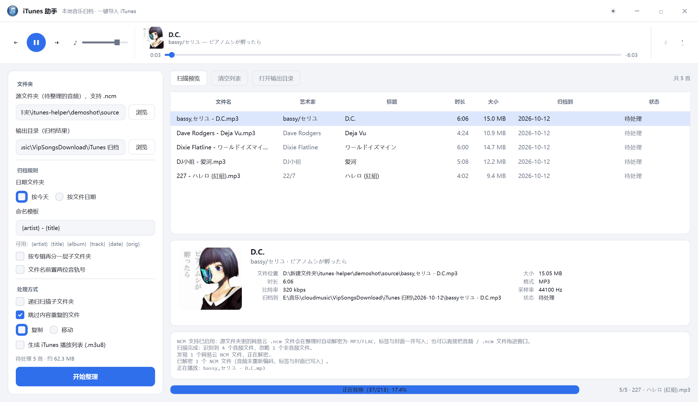
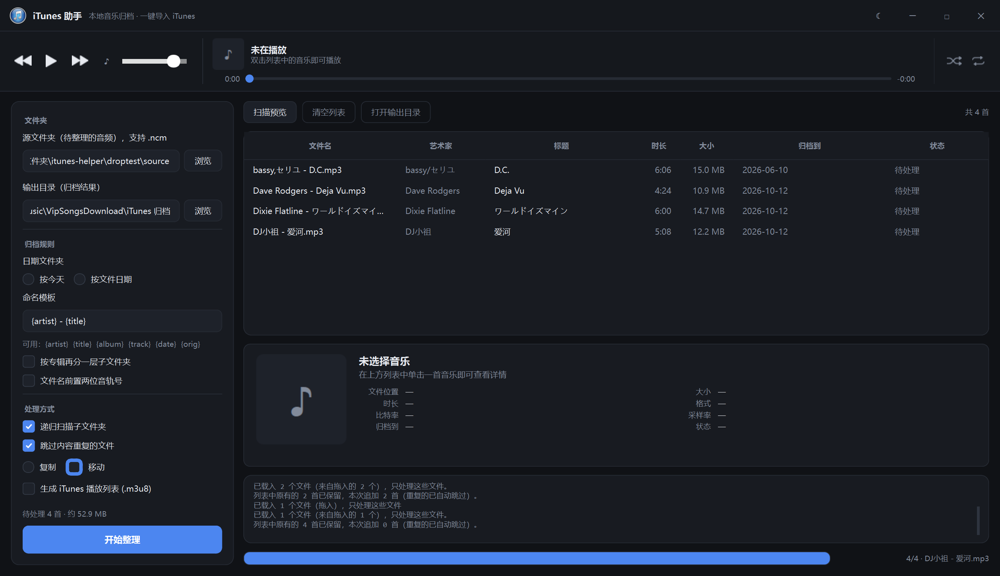

# iTunes 助手 · NCM 集成版

一个本地音乐归档工具，带网易云 `.ncm` 支持，界面是 iTunes 的样子：
顶部播放器栏、列表下方详情面板、内嵌播放。

> **`.ncm` 集成版和基础版是同一个程序** —— 构建脚本只替换 PyInstaller 归档里的
> 入口脚本，其余 164 个条目逐字节保持不变。编译好的成品在 **Releases** 里。



---

## 它做了什么

### 1. 网易云 `.ncm` → MP3 / FLAC

把这个程序接上了完整的 NCM 解密链路：

* **纯标准库实现**，包括自己写了一个 AES-128-ECB（不依赖 pycryptodome）
* 正确区分 OLD / NEW 两种密钥布局，处理 padding、`cover_frame_len` 与 `cover_len` 不一致、
  零长度封面、DJ 版元数据等边界情况
* **音频数据一个比特都没有重新编码** —— 解出来是啥就是啥
* 解密后把标签（标题/艺术家/专辑/音轨号）和内嵌封面写回去，再走原有的
  命名模板 / 按日期归档 / 去重 / 生成 m3u8 播放列表流程

### 2. iTunes 风格播放器栏


* 左：上一曲 / 播放暂停 / 下一曲 / 音量；中：专辑封面 + 歌曲信息（上）、进度条（下）；右：随机 / 循环
* 时间显示按 iTunes 的习惯：左边已播 `0:03`，右边是**负数剩余时间** `-6:03`
* 音量滑杆按参考图复刻：细灰轨道 + 大白色圆滑块

| 浅色 | 深色 |
|---|---|
|  |  |

### 3. 列表与详情



* 单击列表任意一行，下方显示专辑封面、文件位置、大小、时长、格式、比特率、采样率、归档目标
* 双击在软件内播放
* 把音频 / `.ncm` 文件直接拖进窗口会**追加**到列表（不清空原有歌曲，重复的文件自动去重）
* 外观三态：浅色 / 深色 / **跟随系统**（读 Qt 的 `colorScheme()`，系统切换时实时跟着变）

---

## 两个值得说的技术点

### 播放后端用的是 Windows MCI，不是 QtMultimedia

原程序打包时只带了 QtCore / QtGui / QtNetwork / QtSvg / QtWidgets，
**没有 QtMultimedia**，也没法补装。所以播放走 Windows 自带的
**MCI**（`winmm.dll` + ctypes），零依赖。

> **踩过的坑**：MCI 的 MP3 解析器打不开带**大 ID3v2 标签**的文件 ——
> 网易云下载的歌经常内嵌 1~2 MB 封面，会直接报「初始化 MCI 时发生问题」。
> 解决办法是直接打开失败时把 MPEG 音频帧抽出来写成临时副本再播放，
> **原文件绝不被修改**，副本按 (路径, 大小, mtime) 缓存复用。
> 实测 15 MB / 1.1 MB 标签的文件：抽取 92 ms，打开 229 ms，跳转精确到毫秒。

### 应用图标：原地替换 PE 资源段里的 7 个尺寸


原程序是 PyInstaller onefile 打包的，图标同时存在于两处：CArchive 里的
`assets/app.png` / `app.ico`（Qt 用）和 PE 资源段里的 7 个尺寸（资源管理器用）。

PE 资源段的数据区**只剩 115 字节余量**，根本放不下新图标，所以每个尺寸都必须压进原尺寸的预算：

| 尺寸 | 16 | 24 | 32 | 48 | 64 | 128 | 256 |
|---|---|---|---|---|---|---|---|
| 原预算 | 380 | 527 | 743 | 1087 | 1543 | 3386 | 8214 |
| 新图标 | 270 | 381 | 537 | 864 | 1182 | 2898 | 6956 |

做法是抠出圆盘 → 圆形 alpha 遮罩 → 量化到 64 色 → PNG 最大压缩。
**结果是原地覆盖即可，完全不用改 PE 头、节表或资源目录** —— 风险最低。

> 这里有个反直觉的坑：**Qt 的 PNG `quality` 参数是反的**，`0` 才是最大压缩、`100` 几乎不压。
> 一开始用 100，怎么压都是 40 KB；改成 0 之后直接降到 12 KB。

替换后用 **Windows 自己的 API 验证**：`LoadLibraryEx` 作为数据文件打开成功，
`PrivateExtractIconsW`（资源管理器取图标走的就是这个接口）7 个尺寸全部成功。

---

## 顺带修掉的原版缺陷

| 问题 | 现象 | 修法 |
|---|---|---|
| **worker 信号直连界面槽** | `progress` / `preview` / `job_done` 都是直连的，界面槽直接在 worker 线程里改表格模型和进度条。Qt 控件不是线程安全的，主线程同时碰控件树就会随机 `0xC0000005` 崩溃 | 完全不动界面槽，改在 `core.scan_folder` / `core.execute_jobs` 的回调里记录进度 |
| **扫描后界面永久忙碌** | `Worker` 自带 `finished` 信号，但 `do_scan` 只 emit preview、**从不 emit finished**（只有 `do_run` 会）。于是 `_running` 永远是 True，点过一次「扫描预览」后两个按钮就再也点不动 | `do_scan` 结束时置标志位，主线程看门狗调用 `_teardown_worker()` 收尾 |
| **`dragMoveEvent` 没被接管** | Qt 拖动时会持续派发 `dragMoveEvent`，默认实现不接受 → 光标变禁止符号 → 松手根本不派发 `dropEvent` | 补上 `dragMoveEvent` |
| **Windows 深色模式下界面花色** | QSS 里 `QWidget#Root` 是死规则（没有控件叫 Root），标题栏也没开 `WA_StyledBackground`，两处背景一直跟随系统深浅色 | 补上 `objectName="Root"` 与 `WA_StyledBackground` |

---

## 怎么用

### 直接下载编译好的版本

去本仓库的 **Releases** 页面下载 `iTunes助手.NCM版.exe`。

> **首次运行前必读**
>
> 双击如果报 `could not create temporary directory`，是因为 exe 被打上了
> **低完整性级别（Low Mandatory Level）** 标签 —— 带这个标签的 exe 双击时进程也以
> 低完整性运行，而 PyInstaller 单文件程序必须先往 `%TEMP%` 解包，低完整性进程
> 写不进去。管理员 = 高完整性可以降级写入，所以右键管理员运行反而正常。
>
> 解决办法：运行同目录的 **`首次运行-安装到桌面.cmd`**。它会复制到普通目录
> （继承来的标签不会随复制带走，通常这一步就好了）、校验、在桌面建快捷方式并启动。
>
> 注意「发送到桌面快捷方式」没用 —— 那只是个 `.lnk`，指向的还是带标签的原件。

### 从源码构建

需要：

* **Python 3.14**（基础版用的是 3.14，pyc 魔数必须对得上）
* **Node.js**（只有生成 AES 测试向量和 e2e 样本的两个脚本用得到）
* 一份**基础版本**的 `iTunes助手.exe`，放到本目录下 —— 构建就是在它的基础上做替换

```bash
python run_all_tests.py     # 一键跑完 10 步验证并重建产物
```

它会依次：生成测试向量 → 生成图标素材与安装脚本 → NCM 解码核心 → 端到端集成 →
界面集成 → 拖放事件链 → 第二/三版功能 → 重建 exe → 用编译进 exe 的入口代码做冒烟测试。

单独跑某一层：

```bash
python test_ncm_core.py       # 26 项：AES / 密钥流 / 容器
python test_integration.py    # 40 项：解密 → 打标签 → 归档
python test_drag_drop.py      # 22 项：真实 dragEnter → dragMove → drop 事件链
python test_v2_features.py    # 34 项：拖入追加 / 详情面板 / 播放器
python test_v3_features.py    # 52 项：外观三态 / 播放器布局 / 进度文字 / 图标
```

### 仓库结构

```
ncm_core.py          NCM 容器解码（纯标准库，含自研 AES-128-ECB）
ncm_audio.py         MCI 播放后端
ncm_media.py         标签 / 封面 / 详情读取
ncm_tags.py          标签与封面写入
ncm_ui.py            播放器栏 + 详情面板 + 播放控制器 + 主题三态
ncm_glyphs.py        播放器控件图标（自动生成）
ncm_patch.py         core 与界面的补丁

main_patched.py      入口脚本
pyi_tool.py          PyInstaller CArchive 读写
build_patched_exe.py 重打包：生成合并源码并替换归档条目
build_runtime.py     从原版 exe 重建可运行的本地目录树
make_icons.py        图标生成（含 PE 资源预算校验）
make_player_icons.py 播放器控件图标处理
make_launcher.py     生成 Windows 安装脚本

run_all_tests.py     一键跑完全部验证
test_*.py            分层测试
verify_*.py          针对性验证（图标染色 / 音量滑杆 / 安装脚本）
```

详细实现笔记（含大量踩坑记录）见 **[README-NCM集成.md](README-NCM集成.md)**。

---

## 声明

* 构建脚本会读取**基础版本**的 `iTunes助手.exe`，只在 PyInstaller 归档的入口脚本处
  做替换，其余 164 个条目逐字节保持不变 —— 集成版和基础版是同一个程序。
* `.ncm` 解密功能**仅供个人对自己合法下载的音乐做格式转换与归档**。
  请遵守网易云音乐的服务条款以及你所在地区的法律。
* 仓库中的 `icon-source.png` 是 iTunes 图标，版权归 Apple Inc. 所有，
  这里仅作为个人项目的界面素材使用。
* 音量滑杆与播放器控件的样式参考了 iTunes 的视觉设计。

## 许可

[MIT](LICENSE)
